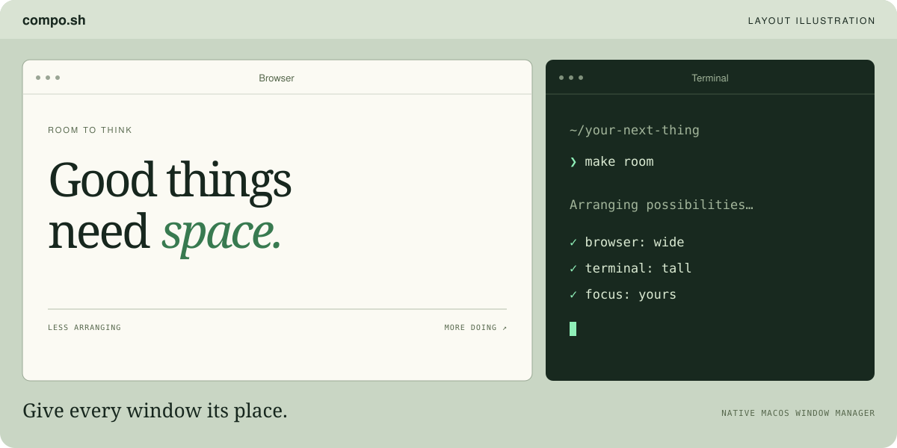

<p align="center">
  
</p>

<h1 align="center">compo.sh</h1>
<p align="center"><strong>A little order. A lot of room.</strong><br />An app-aware window manager for macOS.<br />the yabai killer</p>

<p align="center">
  <a href="https://github.com/virajshoor/compo.sh/releases/latest/download/compo.sh-macOS.zip"><strong>Download for Mac ↗</strong></a>
  &nbsp; · &nbsp; <a href="Resources/compo.sh-guide.pdf">Read the guide</a>
  &nbsp; · &nbsp; <a href="#build-from-source">Build from source</a>
</p>
<p align="center">macOS 13+ &nbsp; / &nbsp; Apple silicon + Intel &nbsp; / &nbsp; MIT licensed</p>



Your browser needs room to breathe. Your terminal likes to stand tall. compo.sh gives each window its place, then stays in your menu bar while you work.

Native Swift, AppKit, and SwiftUI. No third-party runtime dependencies. No account, telemetry, screen recording, or SIP changes.

> **Public beta.** Version 0.3.0 is Developer ID signed and Apple notarized, with the notarization ticket stapled to the app. Fresh installs start paused. Enable Automatic Tiling when you are ready.

## Made for the way you work

| Make room | Make it yours |
| :--- | :--- |
| **App-aware layouts.** Browser + terminal gets a 60/40 split. Browser + document gets equal tall panes. Two browsers get wide rows. | **Simple controls.** Pick Stack, Columns, or Rows; adjust gaps and main pane width. |
| **Layouts that fit.** Narrow companion columns become a balanced grid. Wider displays keep tall companion panes when space allows. | **Per-app rules.** Override app roles or keep an app floating with a small JSON file. |
| **Preview, then place.** Drag to edges or corners for a foreground snap preview. Drag over another managed window to swap. | **Keyboard control.** Focus, swap, float, zoom, pause, and retile without reaching for the mouse. |
| **Quiet by design.** Window events drive tiling. Window placement is instant by default, with visible drag previews. No continuous window polling. | **Silent startup.** Optional launch at login starts in the menu bar. Preferences survive updates with the same app identity. |

## New in 0.3.0

| Feature | How it helps |
| :--- | :--- |
| **Overlap recovery** | Checks settled window positions and tries one constraint-aware refit per arrangement. If apps refuse placement or their minimum sizes cannot fit, controls explain what needs attention. |
| **Undo arrangements** | Press `⌃⌥ Z` to restore the previous arrangement of surviving windows on the current desktop. |
| **Saved workspaces** | Name and save your panes, then restore app placement, relative sizes and floating state. Missing apps launch; display identities help restore across monitor changes. Open documents first. |
| **Editable shortcuts** | Choose **Edit Shortcuts…**, change the JSON bindings, then **Reload Shortcuts**. Invalid or conflicting bindings preserve the previous working configuration. |
| **Private diagnostics** | **Export Diagnostics…** saves local geometry and recent placement events for troubleshooting, without window titles, document paths, content or screenshots. Nothing uploads automatically. |
| **Desktop indicator** | Optional **Show Desktop Indicator** briefly shows the confirmed desktop number without taking focus or adding animation. |

Instant desktop switching remains available with `⌃⌥⌘ ← / →` on macOS 26.6+. Keep modifiers held and tap either arrow repeatedly; holding an arrow triggers only one switch. No SIP changes or system-wide Reduce Motion changes.

## Get started

1. [Download compo.sh](https://github.com/virajshoor/compo.sh/releases/latest/download/compo.sh-macOS.zip), unzip, and move **compo.sh.app** to **Applications**.
2. Open it. Choose **Allow Accessibility Access…**, then approve compo.sh in **System Settings → Privacy & Security → Accessibility**. This lets it move, resize, and focus windows.
3. Quit other window managers, then enable **Automatic Tiling**. Try App-Aware Layout first.

Click the tiled menu bar icon for controls. The bundled **Open Guide PDF…** works offline. Launch at login is optional and off on a fresh install; manual launches open controls.

**Updating:** quit compo.sh normally, replace the app in the same Applications location, then reopen. Keep its preferences and Application Support folder. Settings persist; macOS may still require renewed approval after a signing or system policy change.

[Release notes and checksums →](https://github.com/virajshoor/compo.sh/releases/latest)

## Your hands. Your rules.

Shortcuts use **Control + Option**; desktop switching adds **Command**. Close the compo.sh panel first; actions target the focused app window.

| Shortcut | Action |
| :--- | :--- |
| `⌃⌥` + arrows | Focus in that direction |
| `⌃⌥⌘` + Left / Right | Previous / next desktop, instant cut |
| `⌃⌥⇧` + arrows | Swap in that direction |
| `⌃⌥ L` | Cycle Stack → Columns → Rows |
| `⌃⌥ Space` | Float or tile the focused window |
| `⌃⌥ Return` | Zoom the focused window |
| `⌃⌥ P` | Pause or resume |
| `⌃⌥ R` | Clear manual placements and retile |
| `⌃⌥ Z` | Undo the last arrangement |

Choose **Edit Shortcuts…** to edit `~/Library/Application Support/compo/shortcuts.json`, then **Reload Shortcuts**. Each entry has `action`, `key`, `modifiers` and `enabled`. Keep all action entries; set `enabled` to `false` to disable one. Keys: lowercase A–Z, 0–9, `left`, `right`, `up`, `down`, `space`, `return`, `escape`. Modifiers: `control`, `option`, `command`, `shift`; enabled shortcuts require Control, Option or Command. Duplicate chords, invalid JSON and shortcuts reserved by other apps show an error and keep the previous working bindings. Physical letter-key positions follow US key codes. Floating and zoom are session-only unless saved in a workspace.

```json
{ "action": "desktop.right", "key": "right", "modifiers": ["control", "option", "command"], "enabled": true }
```

The file contains an array of these entries; Edit Shortcuts creates the complete defaults. File limit: 2 MB.

### Instant desktop switching

On macOS 26.6 and later, `⌃⌥⌘ ← / →` switches adjacent Spaces on the display under the pointer without the sliding transition. It works while tiling is paused, requires Accessibility access, includes fullscreen Spaces, and stops at the first or last Space. Each desktop shortcut acts once per press: holding the arrow does not repeat. Release it before pressing again. Keep Control, Option, and Command held while tapping either arrow successively. Rapid taps queue in order while Dock commits each switch; they are not discarded.

This changes no system-wide Reduce Motion settings. Native trackpad swipes, native Control–Left/Right shortcuts, and other macOS animations keep their existing behavior. Instant cuts use an undocumented Dock gesture protocol; future macOS updates may require compatibility fixes. On older macOS, use native desktop shortcuts.

### Undo, workspaces and diagnostics

**Undo** (`⌃⌥ Z`) restores one previous arrangement after a snap, swap, float, zoom, layout change, retile or workspace restore. It restores surviving windows on the current desktop only; changing desktops clears undo. App size limits still apply.

**Saved Workspaces** records app bundle IDs, display identities and relative pane geometry, including floating panes. Save with a name, choose it, then Restore. Missing apps launch without activation; restoration waits up to six seconds for their windows. Open documents yourself first. Windows within the same app match by visible order, not document title. Missing displays fall back to an available display; tiling refits against known size limits. Extra visible windows remain managed. Save/delete writes atomically to `~/Library/Application Support/compo/workspaces.json` (32 workspaces, 128 panes each). A failed load preserves the existing file.

**Export Diagnostics…** saves a local JSON file containing app/OS versions, display and window geometry, bundle IDs, learned minimums, requested frames and up to 200 recent events with uptime. It includes no window titles, document paths, content or screenshots, and uploads nothing. Review the file before sharing.

**Show Desktop Indicator** briefly displays the confirmed desktop number after Space changes. It takes no keyboard focus and adds no transition animation. Disable it in controls if preferred.

### App rules

Choose **Edit App Rules**, edit the file, then **Reload App Rules**. Invalid JSON keeps the last working rules.

```json
{
  "apps": {
    "com.apple.Safari": { "role": "browser" },
    "com.apple.Terminal": { "role": "terminal" },
    "com.apple.calculator": { "floating": true }
  }
}
```

Rules live at `~/Library/Application Support/compo/config.json`. Use exact bundle identifiers. Allowed roles: `browser`, `terminal`, `document`, `other`. File limit: 256 KB.

## Native, with boundaries

**0.3.0:** adds one-step arrangement undo, saved workspaces, editable shortcuts with duplicate/system conflict checks, local diagnostic export and an optional desktop indicator. Settled overlapping windows receive one recovery attempt per arrangement. Persistent refusal stops placement attempts and shows guidance; impossible minimum-size layouts report why they cannot fit. Instant desktop switching remains unchanged.

**0.2.6:** desktop shortcuts accept one action per press and rearm on release. Holding an arrow no longer repeats through every desktop. Keep modifiers held and tap either arrow repeatedly or alternate directions; quick taps queue in order instead of being discarded during Dock’s commit interval. Window focus and swap shortcuts retain their existing repeat behavior.

**0.2.5:** failed resize writes now still feed stable size constraints into fitting; placement retries a rejected resize after moving to the destination. Visible-window discovery uses WindowServer identities when available, preventing identical frames on different Spaces from being mistaken for the same visible window. Space changes discard the previous desktop’s window list before rediscovery. New desktop shortcuts use instant cuts without changing system-wide motion settings.

**0.2.4:** resize feedback is learned once from two stable observations, then expires; later app resizing cannot inflate old minimums. User interaction cancels pending feedback. When regular grids fail, uneven panes can fit mixed-size windows. Bounded recovery handles width changes that reveal height limits. Placement errors appear near the top of controls.

**0.2.3:** placement skips unchanged frames, corrects origin shifts after resizing, and checks settled sizes before adapting layouts to app minimums. Columns can become rows or a grid to avoid overlap. Activation and geometry events trigger bounded recovery; brief Accessibility/WindowServer mismatches preserve known layout state. Clicks no longer interrupt swap animations, and snaps/swaps use the same constraint-aware layout path, including display crossings.

**0.2.2:** clicking to activate a window cannot trigger a snap or swap. Placement now requires a mouse-drag event, pointer travel, and window movement; content drags and live resizing remain excluded.

**0.2.1:** **Disable All Animations** is on by default, including after upgrading. Edge snaps, drag-to-swap, and keyboard swaps place windows instantly; drag overlays remain visible without appearance animations. Turn this option off to restore swap/replace transitions, which respect Reduce Motion. Edge snaps stay instant. This preference persists and controls compo.sh window placement; macOS still controls its own Spaces and Mission Control transitions.

compo.sh arranges existing windows through Accessibility. macOS still handles rendering, fullscreen, Mission Control, and Spaces. This is a window manager, not a replacement compositor.

- **Snap Edges:** on macOS 15+, compo.sh saves native edge/top/Option tiling preferences and disables competing previews while snapping is active. Turning snapping off, pausing, or quitting normally restores them. These preferences are undocumented and may change after OS updates.
- **After a crash:** reopen compo.sh, then pause or turn off Snap Edges to restore saved native settings. If needed, adjust tiling in System Settings → Desktop & Dock.
- **App limits:** compo.sh learns enforced minimum sizes and tries fitting rows, columns, grids, and ordered uneven partitions. This is not exhaustive rectangle packing. If no supported layout fits, or an app rejects writes, the menu reports the problem; float a window or use fewer panes. Retile Now clears learned limits and retries. Dialogs, minimized windows, native fullscreen windows, hidden apps, and compo.sh itself are excluded.
- **Manual placement:** snaps and swaps remain until window membership changes or you choose Retile Now, provided they fit the display and app minimums. Zoom intentionally covers other panes. Quitting does not restore earlier window frames.
- **Privacy:** no app network requests or screen capture. Window metadata is read locally to manage visible windows. The distributed app's signing certificate publicly identifies its developer.

Pause anytime with `⌃⌥ P`. Before uninstalling, turn off Launch at Login, quit normally, then remove the app. Revoke Accessibility access in System Settings if desired.

## Build from source

Requires macOS, Xcode Command Line Tools, and Swift 5.9 or later. Deployment target: macOS 13.

```sh
git clone https://github.com/virajshoor/compo.sh.git
cd compo.sh
bash scripts/build.sh
```

Output: `dist/compo.sh.app`, universal for Apple silicon and Intel. The script builds and packages only; it never installs, launches, or enables login startup. Its default signature is ad hoc. Put the app in its permanent location before granting Accessibility access.

The current signed, notarized app bundle is also checked into [`dist/compo.sh.app`](dist/compo.sh.app), with its notarization ticket stapled. The release ZIP contains the same bundle.

For your own Developer ID signature:

```sh
COMPO_SIGN_IDENTITY='Developer ID Application: Your Name (TEAMID)' bash scripts/build.sh
```

Local builds are not automatically notarized. Submit your signed ZIP with `xcrun notarytool`, then staple the accepted ticket on your Mac. Rebuilding with a different identity can require renewed Accessibility approval.

### Checks

```sh
swift test
swiftc Sources/Compo/LaunchBehavior.swift Tests/LaunchBehaviorCheck.swift -o /tmp/compo-launch-check
/tmp/compo-launch-check
```

54 Swift tests cover arrangement snapshots, workspace validation and display remapping, shortcut validation, bounded diagnostics, settled overlap recovery, layouts, app hierarchy, narrow and ultrawide displays, gaps, non-overlap, directional focus, snap zones, click-versus-drag placement intent, minimum-size fitting, shifted origins, refused writes, discovery races, simulated activation recovery, six-window uneven fitting, stale or unsettled resize feedback, rejected resize recovery, cross-Space window identities, desktop boundaries, gesture encoding, shortcut hold/release behavior, rapid alternating desktop taps, and delayed queue dispatch. Desktop gesture tests construct events without posting them. The launch check covers four synthetic launch events. They do not move real desktop windows; app compatibility and actual login behavior need hands-on testing.

### Around the source

| Path | Purpose |
| :--- | :--- |
| `Sources/CompoCore/` | Layouts, app roles, focus geometry, snap zones |
| `Sources/Compo/` | Menu bar UI, Accessibility, hotkeys, dragging, native tiling preferences |
| `Tests/` | Geometry tests and login launch checks |
| `Resources/` | App metadata, logo, offline PDF guide |
| `scripts/build.sh` | Universal bundle packaging and signing |
| `scripts/Icon.swift` | App icon generation |
| `scripts/Guide.py` | PDF guide source; regenerate with Python + ReportLab |

## Contribute

Bug reports and focused pull requests welcome. For layout bugs, include macOS version, display arrangement, affected app names, and steps to reproduce. Remove private window titles and content before sharing screenshots.

[Open an issue](https://github.com/virajshoor/compo.sh/issues) · [MIT license](LICENSE) · [Third-party notices](THIRD_PARTY_NOTICES.md)

<p align="center"><sub>Less arranging. More doing.</sub></p>
